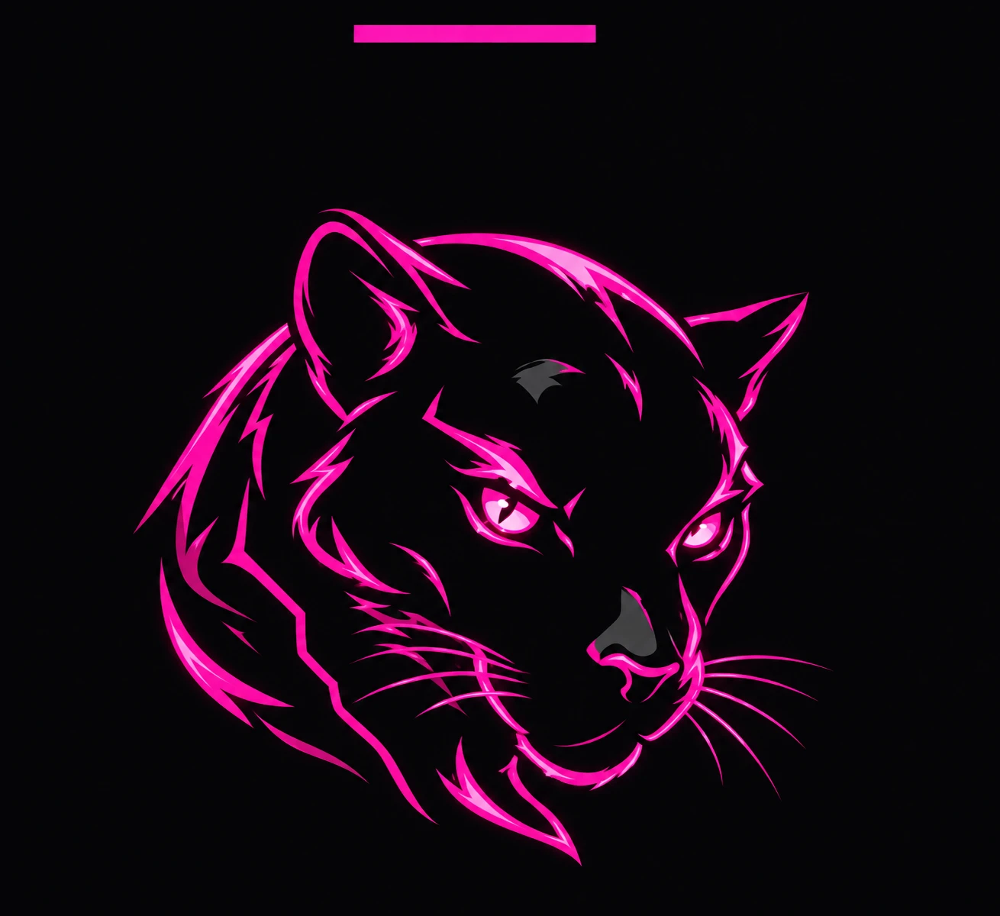

  

<h1 align="center">Be Safe AD Lab</h1>

  <b>Um laboratório gratuito para aprender Active Directory de verdade: administração, IAM e PAM.</b> 
  Windows Server e Windows 11 reais, montados na sua máquina por um script. Tudo offline depois de pronto.

> **Status:** em construção. Este repositório ainda não gera um lab funcional.

## A ideia

Você entra como estagiária ou estagiário de infraestrutura na **Be Safe Corp**, e um veterano ensina do zero a administrar e proteger o domínio `besafe.local`. Nada de simulação: você usa o ADUC, o GPMC e o PowerShell de verdade, num domínio de verdade.

## O que você aprende

| # | Módulo |
|---|---|
| 0 | Boas-vindas e montagem do lab |
| 1 | Domínio, controlador de domínio e DNS |
| 2 | Usuários, grupos e OUs |
| 3 | GPO |
| 4 | Kerberos e NTLM sem mistério |
| 5 | Permissões e delegação |
| 6 | **IAM:** SSO, MFA e o ciclo de vida da identidade |
| 7 | **PAM:** camadas, LAPS, JIT e bastion com gravação de sessão |
| 8 | Auditoria e logs do AD |
| 9 | Caso final: auditar um domínio bagunçado e corrigir |

## Como o lab é montado

A licença de avaliação da Microsoft não permite distribuir a máquina virtual pronta. Por isso o lab é **montado na sua máquina**: o instalador baixa as ISOs de avaliação direto da Microsoft, cria as VMs e configura o domínio inteiro sozinho.

| VM | Papel | RAM |
|---|---|---|
| `DC01` | Windows Server 2022: AD DS, DNS, GPO, Windows LAPS | 4 GB |
| `WS01` | Windows 11 Enterprise no domínio | 4 GB |
| `LAB` | Debian: treinamento, console de correção, Keycloak e Guacamole | 4 GB |

**Requisitos:** processador x86 com virtualização ligada, 16 GB de RAM, 4 núcleos e cerca de 100 GB livres. As licenças de avaliação valem 180 dias (Server) e 90 dias (Windows 11); depois disso é só montar o lab de novo.

Detalhes em [docs/arquitetura.md](docs/arquitetura.md).

## Licença

Código e treinamento sob [MIT](LICENSE). Windows Server e Windows 11 são da Microsoft e são baixados por você, sob os termos de avaliação da Microsoft.

Powered By Mariana BS

